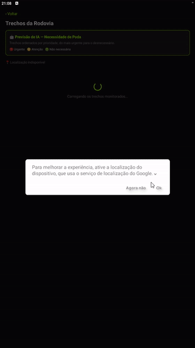
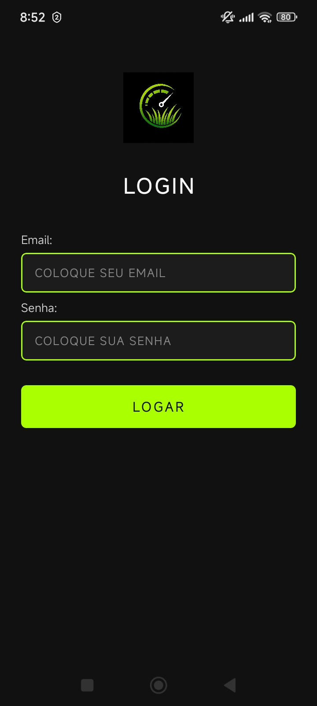
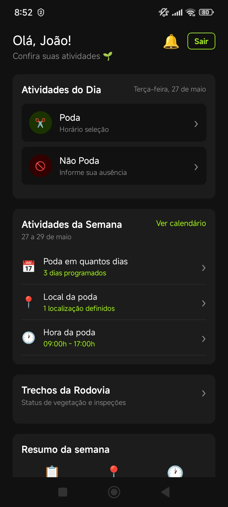
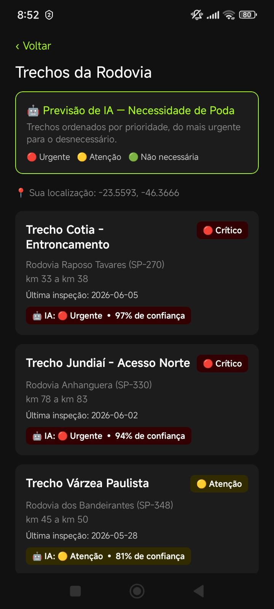
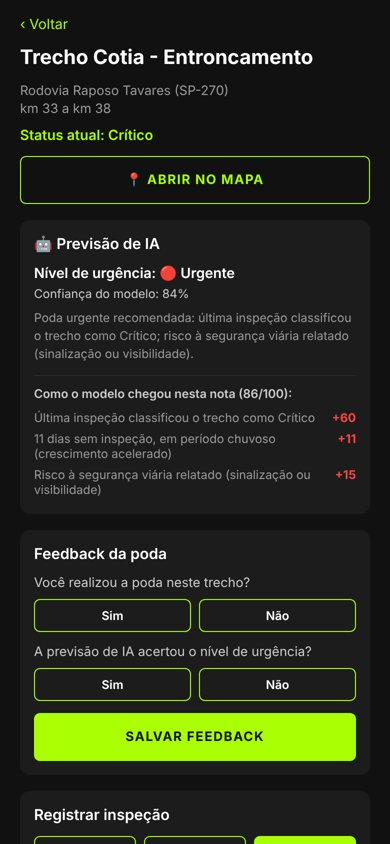
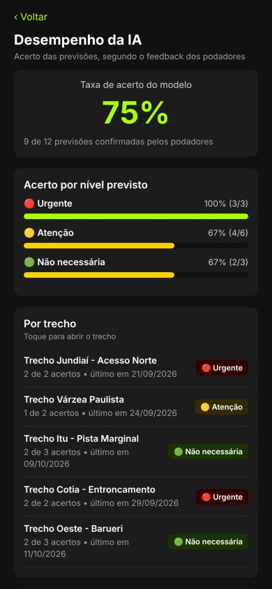

# PrognosisHerba

**Gestão de poda e roçada em rodovias concedidas. Challenge CCR Motiva, Sprints 1 a 4.**

App Android para as equipes de conservação vegetal da Motiva. Ele prevê quais trechos precisam de
poda, organiza a escala das equipes e registra em campo, com foto e GPS, o que foi feito. Esse
registro volta para o modelo de previsão.

| | |
|---|---|
| **APK para download (v1.0.0)** | **[PrognosisHerba-v1.0.0.apk](https://github.com/Zinorblatant-cpu/PrognosisHerba/releases/download/v1.0.0/PrognosisHerba-v1.0.0.apk)** ([página da release](https://github.com/Zinorblatant-cpu/PrognosisHerba/releases/tag/v1.0.0)) |
| **Vídeo de pitch e demonstração** | **[INSERIR LINK DO YOUTUBE (não listado)]** |
| **Plano de negócio** | [PLANO_DE_NEGOCIO.md](./PLANO_DE_NEGOCIO.md), com resumo na [seção 9](#9-plano-de-negócio-resumo) |
| **Testes manuais** | [TESTES_MANUAIS.md](./TESTES_MANUAIS.md) |
| **Protótipo Figma** | [PrognosisHerba no Figma](https://www.figma.com/design/U65XJovakZgKdhKiMNkwNe/PrognosisHerba?node-id=0-1&t=kPh46l4wXuSrPu0r-0) |
| **Conta de demonstração** | `joao@motiva.com`, senha `senha123` |

---

## Sumário

1. [Problema](#1-problema)
2. [Proposta de solução](#2-proposta-de-solução)
3. [Instalar o APK](#3-instalar-o-apk)
4. [Telas](#4-telas)
5. [Funcionalidades e fluxo](#5-funcionalidades-e-fluxo)
6. [Como funciona a previsão de IA](#6-como-funciona-a-previsão-de-ia)
7. [Stack](#7-stack)
8. [Rodar, testar e gerar o APK](#8-rodar-testar-e-gerar-o-apk)
9. [Plano de negócio (resumo)](#9-plano-de-negócio-resumo)
10. [Entregas por Sprint](#10-entregas-por-sprint)
11. [Sprint 4: o que mudou](#11-sprint-4-o-que-mudou)
12. [Por que não migramos para Flutter](#12-por-que-não-migramos-para-flutter)
13. [Requisitos](#13-requisitos)
14. [Limitações conhecidas](#14-limitações-conhecidas)
15. [Estrutura do projeto](#15-estrutura-do-projeto)
16. [Integrantes](#16-integrantes)

---

## 1. Problema

A Motiva administra **13 concessões e cerca de 5 mil km de rodovias**, e a conservação da faixa
de domínio (roçada, capina e poda) é obrigação contratual em todas elas. Hoje:

- o cronograma de roçada é **fixo**, mas o crescimento da vegetação não é. No período chuvoso
  ela cobre placas e curvas; no seco, a equipe roça trecho que não precisava;
- o registro de campo é **manual**, sem foto nem localização, e se perde até chegar ao planejamento;
- quem está no campo **não tem como dizer** se a prioridade definida estava certa.

Em janeiro de 2026 a própria ANTT alertou as concessionárias sobre o crescimento excessivo de
vegetação no período chuvoso, com impacto na visibilidade da sinalização, na drenagem e na
segurança. Os detalhes e as fontes estão no [plano de negócio](./PLANO_DE_NEGOCIO.md).

## 2. Proposta de solução

> **Roçar o trecho certo, na hora certa, com prova de que foi feito.**

1. **Prever:** cada trecho recebe uma nota de 0 a 100 e um nível (Urgente, Atenção ou Não
   necessária), calculados a partir do status, do tempo sem inspeção, da época do ano e do risco
   à sinalização. A nota mostra os fatores que a compõem.
2. **Executar:** o podador vê a escala da semana, confirma a poda do dia (ou justifica a
   ausência), encontra o trecho mais próximo pelo GPS e abre a rota no app de mapas.
3. **Registrar:** a inspeção leva status, observação e **foto da câmera**, e a previsão é
   recalculada na hora.
4. **Validar:** o podador responde se a previsão acertou. A tela **Desempenho da IA** consolida
   a taxa de acerto por nível e por trecho, formando a base de treino do modelo.

**Persona principal:** Carlos Henrique, 38 anos, Supervisor de Conservação Rodoviária. Ele
precisa organizar as equipes de poda, acompanhar o que foi feito e padronizar os registros. As
outras personas (podador e gerente de conservação) estão no
[plano de negócio](./PLANO_DE_NEGOCIO.md#3-público-alvo-e-personas).

## 3. Instalar o APK

> O APK **não fica no repositório**, porque binários não são versionados. Ele está publicado no
> **GitHub Releases**.

1. No celular Android (7.0 ou superior), abra o link
   **[PrognosisHerba-v1.0.0.apk](https://github.com/Zinorblatant-cpu/PrognosisHerba/releases/download/v1.0.0/PrognosisHerba-v1.0.0.apk)**.
2. Toque em **Baixar**. Se o Android avisar sobre o arquivo, toque em **Baixar mesmo assim**.
3. Abra o arquivo baixado. Na primeira vez, o Android pede para **permitir instalar apps desta
   fonte** (navegador ou gerenciador de arquivos). Permita e volte.
4. Toque em **Instalar** e depois em **Abrir**.
5. Entre com a conta de demonstração **`joao@motiva.com`** e senha **`senha123`**, ou crie uma conta.
6. Aceite as permissões quando forem pedidas: **localização** (ao abrir *Trechos da Rodovia*) e
   **câmera** (ao fotografar uma inspeção).

**Para a banca, estados de erro e lista vazia:** na build instalada o *Modo de demonstração*
fica oculto. Para liberá-lo, vá em **Perfil** e toque 5 vezes na versão do app, no rodapé. Ele
permite simular lista vazia, erro de conexão e resposta lenta em todas as telas.

## 4. Telas

<p align="center">
  
</p>

<table>
  <tr>
    <td align="center"><b>Login</b><br/></td>
    <td align="center"><b>Registro</b><br/></td>
    <td align="center"><b>Dashboard</b><br/></td>
  </tr>
  <tr>
    <td align="center"><b>Trechos, previsão de IA</b><br/></td>
    <td align="center"><b>Detalhe, fatores da previsão</b> <sub>(Sprint 4)</sub><br/></td>
    <td align="center"><b>Desempenho da IA</b> <sub>(Sprint 4)</sub><br/></td>
  </tr>
</table>

## 5. Funcionalidades e fluxo

```txt
Inicialização
    │
    ├─ Sessão salva? ──Sim──▶ Dashboard
    │
    └─ Não ──▶ Registro ⇄ Login ──▶ Dashboard
                  │          └──▶ Esqueci minha senha (código → nova senha)
                  │
   Dashboard ─┬─▶ Notificações ───────────────┐
              ├─▶ Agenda da semana ───────────┤
              ├─▶ Confirmar poda / Ausência   │
              ├─▶ Trechos da Rodovia ─────────┼──▶ Detalhe do trecho
              ├─▶ Desempenho da IA ───────────┘      ├─ previsão + fatores
              └─▶ Perfil                              ├─ abrir no mapa
                    ├─ Modo de demonstração           ├─ inspeção + foto
                    └─ Logout                         └─ feedback da IA
```

Nenhuma tela fica sem saída e nenhum botão fica sem ação.

| # | Funcionalidade | Status |
|---|---|---|
| 1 | Cadastro com validação (email, senha com no mínimo 6 caracteres, confirmação obrigatória) | Feito |
| 2 | Login, sessão persistida e logout com pilha resetada | Feito |
| 3 | **Recuperação de senha** com código de 6 dígitos, validade e limite de tentativas | Feito na Sprint 4 |
| 4 | **Senha protegida** com salt e SHA-256 iterado, com migração de contas antigas | Feito na Sprint 4 |
| 5 | Dashboard com atividades do dia, semana, resumo e contador de notificações | Feito |
| 6 | Agenda da semana **ligada à data real do aparelho** | Feito na Sprint 4 |
| 7 | Confirmar poda (turno) e informar ausência (motivo e justificativa) | Feito |
| 8 | Notificações com leitura individual e em massa | Feito |
| 9 | Trechos com status, filtros, GPS e trecho mais próximo | Feito |
| 10 | **Previsão de IA calculada no app**, com nota, confiança e fatores | Feito na Sprint 4 |
| 11 | Inspeção com **foto (câmera ou galeria)** | Feito na Sprint 4 |
| 12 | **Abrir trecho no app de mapas** | Feito na Sprint 4 |
| 13 | Feedback do podador e **tela Desempenho da IA** | Feito na Sprint 4 |
| 14 | Perfil do operador | Feito |
| 15 | Estados de carregamento, erro (com nova tentativa) e vazio em todas as listas | Feito |
| 16 | Modo de demonstração **oculto na build de release** | Feito na Sprint 4 |
| 17 | **Acessibilidade**: rótulos para leitor de tela e contraste revisado | Feito na Sprint 4 |
| 18 | Integração com API real e sincronização entre aparelhos | Fora do escopo, ver a [seção 14](#14-limitações-conhecidas) |

## 6. Como funciona a previsão de IA

Até a Sprint 3 a previsão era um campo fixo do mock. Na Sprint 4 ela passou a ser **calculada
no aparelho** pelo `PrevisaoIAService`, a cada leitura. Se o operador registra uma inspeção, a
nota muda na hora.

É um **modelo de pontuação explicável**, de 0 a 100. Cada fator vira uma linha na tela de detalhe:

| Fator | Pontos |
|---|---|
| Status da última inspeção | Crítico **+60**, Atenção **+35**, Conforme **+10** |
| Dias sem inspeção | **+1,0 por dia** no período chuvoso (outubro a março), **+0,5 por dia** no seco |
| Piorou entre as duas últimas inspeções | **+10** (se melhorou, **−5**) |
| Observação cita placa, sinalização, visibilidade, curva etc. | **+15** |
| Última inspeção "Conforme" registrando poda realizada | **−10** |

**Nível:** a partir de 70 é Urgente, a partir de 40 é Atenção, abaixo de 40 é Não necessária.
**Confiança:** cresce com a distância da nota até o limiar mais próximo e com o número de inspeções.

Somos diretos sobre o que isso é: **um baseline heurístico, não um modelo treinado**. Os pesos
foram definidos pela equipe, não aprendidos a partir de dados. Ele existe para duas coisas. A
primeira é já priorizar os trechos de forma coerente e explicável. A segunda é gerar, com o
feedback dos podadores, o conjunto rotulado que vai treinar o modelo de machine learning da
próxima fase. A tela **Desempenho da IA** mede exatamente isso.

## 7. Stack

| Tecnologia | Versão | Uso |
|---|---|---|
| React Native | 0.81.5 | App mobile |
| Expo (SDK 54) e EAS Build | ~54.0.33 | Ambiente, build e geração do APK |
| React Navigation | 7 | Navegação em pilha |
| AsyncStorage | 2.2.0 | Persistência local (sessão, trechos, agenda, feedbacks) |
| expo-location | ~19.0.8 | GPS e trecho mais próximo |
| **expo-image-picker** | ~17.0.11 | **Câmera e galeria na inspeção (Sprint 4)** |
| Jest, jest-expo e Testing Library | 29, 54 e 13 | Testes automatizados |

**Por quê:** React Native com Expo atende Android e iOS com uma base de código só, e o EAS Build
gera o APK sem exigir Android Studio na máquina de cada integrante. Os recursos nativos (GPS e
câmera) vêm de módulos oficiais do Expo, com as permissões declaradas no `app.json`.

## 8. Rodar, testar e gerar o APK

```bash
npm install          # dependências
npm start            # Expo (abra no Expo Go ou emulador)
npm test             # 233 testes automatizados
```

### Gerar o APK (EAS Build)

O `eas.json` já tem o perfil `preview`, que gera **APK instalável**. O perfil `production` gera
`.aab` para a Play Store.

```bash
npm install -g eas-cli
eas login                                    # conta gratuita em expo.dev
eas build -p android --profile preview       # na 1ª vez, aceite criar o projeto e a keystore
```

Ao terminar, o EAS mostra o link do `.apk`. Baixe, renomeie para `PrognosisHerba-v1.0.0.apk` e
publique em **GitHub, Releases, Draft a new release** com a tag `v1.0.0`. O link do topo deste
README passa a funcionar automaticamente.

| Perfil | Saída | Modo de demonstração |
|---|---|---|
| `development` | APK | visível desde o início |
| `preview` | **APK (entregue)** | oculto, liberado com 5 toques na versão |
| `production` | AAB (Play Store) | oculto |

## 9. Plano de negócio (resumo)

O documento completo, com premissas e fontes, está em **[PLANO_DE_NEGOCIO.md](./PLANO_DE_NEGOCIO.md)**.

- **Proposta de valor:** priorizar a roçada pela necessidade prevista do trecho, e não pelo
  calendário, com evidência de execução para a fiscalização.
- **Posicionamento:** a Motiva já testa IA com imagens de satélite no Rodoanel. O PrognosisHerba
  é a **camada de campo** que falta, porque confirma a execução e mede se a previsão acertou.
  Ele alimenta esse modelo em vez de competir com ele.
- **Público:** concessionárias de rodovias, com a Motiva como cliente principal e **piloto
  proposto na Motiva Autoban (319,8 km)**.
- **Receita:** piloto pago de **R$ 60 mil** (5 meses), licença SaaS de **R$ 45 por km por mês**
  (usuários ilimitados) e serviços de integração opcionais.
- **Custo de operação (estimado):** cerca de R$ 100 mil por mês na escala completa, com ponto de
  equilíbrio perto de 2.200 km.
- **Por que se paga (estimativa):** a roçada na malha da Motiva custa na ordem de **R$ 124 mi
  por ano** (custo direto SICRO em SP). Evitar ou realocar **3 a 5%** dos ciclos economiza
  **R$ 3,7 a 6,2 mi por ano**, contra **R$ 2,7 mi** de licença.
- **Maior risco:** sobreposição com a IA de satélite da Motiva, mitigada pela integração.

## 10. Entregas por Sprint

| Sprint | Foco | Telas | Testes | Principais entregas |
|---|---|---|---|---|
| **1** | Base e autenticação | 3 | sem registro | Registro, login, sessão, dashboard, identidade visual, Figma |
| **2** | Dados e recurso nativo | 5 | 87 | Trechos, mock de dados, **GPS**, previsão de IA (mock), inspeção, feedback |
| **3** | Protótipo funcional completo | 9 | 179 | Notificações, agenda, poda e ausência, perfil, **cenários de mock**, componentes reutilizáveis, testes manuais |
| **4** | **Versão final e negócio** | **11** | **233** | **APK**, previsão calculada, Desempenho da IA, **câmera**, mapa, recuperação de senha, hash de senha, agenda real, acessibilidade, **plano de negócio** |

## 11. Sprint 4: o que mudou

### Pontos do documento de testes da Sprint 3

| # | Ponto (TESTES_MANUAIS, seção 4) | Situação na Sprint 4 |
|---|---|---|
| P1 | Senha em texto puro no AsyncStorage | **Resolvido.** Salt por conta e SHA-256 iterado 1.000 vezes, validado contra os vetores do NIST. Contas antigas migram no primeiro login |
| P2 | Sem API real | **Não resolvido.** Exige backend, que é a Fase 1 do plano de negócio. Os services já isolam as telas da origem dos dados |
| P3 | Previsão de IA estática | **Resolvido.** Motor de pontuação calculado no app ([seção 6](#6-como-funciona-a-previsão-de-ia)) |
| P4 | Data "hoje" fixa em 16/06/2026 | **Resolvido.** Agenda, notificações e histórico seguem o relógio do aparelho. No fim de semana o app mostra a próxima diária |
| P5 | Sem recuperação de senha | **Resolvido.** Fluxo com código de 6 dígitos, validade de 10 minutos e bloqueio após 5 tentativas |
| P6 | Feedback da IA sem consolidação | **Resolvido.** Tela *Desempenho da IA* |
| P7 | Sem fila de sincronização offline | **Parcial.** O app funciona 100% offline com dados locais. A fila só faz sentido com o backend (Fase 1) |
| P8 | Inspeção só com texto | **Resolvido.** Foto pela câmera ou galeria, exibida no histórico |
| P9 | Sem mapa | **Resolvido.** "Abrir no mapa" leva o trecho ao app de mapas do aparelho |
| P10 | Modo de demonstração visível | **Resolvido.** Oculto na build de release, liberável com 5 toques |
| P11 | Acessibilidade não revisada | **Resolvido (básico).** Rótulos e estados para leitor de tela em botões, cards, opções e campos. O cinza secundário passou de 4,8:1 para 6,1:1 de contraste |
| P12 | Sem testes E2E | **Não resolvido.** A cobertura segue sendo de unidade e componente (233 testes) |

### Defeitos encontrados e corrigidos nesta Sprint

- **Datas em UTC:** registros feitos depois das 21h (horário de Brasília) eram gravados com a
  data do dia seguinte, porque o código usava `toISOString()`. Agora tudo usa a data local.
- **Confirmação de senha vazia passava no cadastro:** a validação só comparava as senhas quando
  as duas estavam preenchidas.
- **Ícone e splash padrão do Expo:** o app instalado mostraria o ícone genérico do Expo. Agora o
  ícone, o ícone adaptativo e a splash usam a logo do PrognosisHerba.
- **Técnico fixo nas inspeções:** toda inspeção era assinada por "João Silva". Agora usa o
  usuário logado.

### Novos testes

Foram criadas as suítes `PrevisaoIAService`, `DesempenhoIAService`, `DesempenhoIAScreen`,
`EsqueciSenhaScreen`, `PerfilModoDemo` e `sha256`, além de casos novos em `AuthService`,
`AgendaService`, `TrechosService`, `TrechoDetailScreen`, `LocationService`, `RegisterScreen`,
`LoginScreen` e `DashboardScreen`. **Total: 233 testes em 24 suítes**, todos passando. O bundle
Android de produção também foi gerado com `npx expo export --platform android` sem erros.

## 12. Por que não migramos para Flutter

A migração era opcional e **mantivemos React Native com Expo** nas quatro Sprints, então não há
código Flutter a reaproveitar. Os motivos:

- O escopo das Sprints 1 e 2 já estava entregue e testado nessa stack. Migrar significaria
  reescrever telas, services e testes só para voltar ao mesmo ponto.
- O Expo cobre os dois recursos nativos que a solução usa (GPS e câmera) e gera o APK pelo EAS
  Build, que era o entregável da Sprint 4.
- A equipe domina JavaScript e React, o que permitiu usar as Sprints 3 e 4 para **ampliar o
  produto** em vez de reconstruí-lo.
- A suíte de testes cresceu de 87 para 233 casos sem troca de ferramenta, servindo de rede de
  segurança em todas as refatorações.

## 13. Requisitos

### Funcionais

| Código | Requisito |
|---|---|
| RF01 | Cadastro de usuário |
| RF02 | Login |
| RF03 | Validação de email |
| RF04 | Validação e obrigatoriedade da confirmação de senha |
| RF05 | Persistência de sessão |
| RF06 | Visualizar atividades do dia |
| RF07 | Visualizar cronograma semanal |
| RF08 | Logout |
| RF09 | Listar trechos com status de vegetação |
| RF10 | Obter localização via GPS e destacar o trecho mais próximo |
| RF11 | Exibir previsão de IA por trecho, **calculada a partir dos dados do trecho** |
| RF12 | Registrar inspeção com status, observação e **foto opcional** |
| RF13 | Registrar feedback sobre a poda e o acerto da previsão |
| RF14 | Consultar notificações e marcá-las como lidas |
| RF15 | Visualizar a escala da semana |
| RF16 | Confirmar a poda do dia informando o turno |
| RF17 | Informar e justificar ausência |
| RF18 | Filtrar trechos por status |
| RF19 | Consultar perfil operacional |
| RF20 | Comunicar carregamento, listas vazias e erros, com nova tentativa |
| **RF21** | **Recuperar a senha por código de verificação** |
| **RF22** | **Consultar a taxa de acerto da previsão de IA** |
| **RF23** | **Abrir a localização do trecho no app de mapas** |
| **RF24** | **Exibir os fatores que compõem a previsão** |

### Não funcionais

| Código | Requisito |
|---|---|
| RNF01 | Funcionar em Android (APK) e iOS |
| RNF02 | Interface responsiva |
| RNF03 | Navegação intuitiva, sem tela sem saída nem botão sem ação |
| RNF04 | Persistência local de sessão e dados |
| RNF05 | Testes automatizados |
| RNF06 | Identidade visual consistente sobre componentes reutilizáveis |
| RNF07 | Pedir permissão antes de usar GPS e câmera |
| RNF08 | Informar falhas de carregamento com nova tentativa |
| **RNF09** | **Senhas nunca gravadas em texto** |
| **RNF10** | **Datas calculadas no fuso local do aparelho** |
| **RNF11** | **Contraste mínimo WCAG AA (4,5:1) no texto e rótulos para leitor de tela** |
| **RNF12** | **Recursos de simulação ocultos na build de release** |

## 14. Limitações conhecidas

Listamos de propósito o que a banca deve saber antes de avaliar:

- **Sem backend.** Toda a persistência é local (AsyncStorage), então dois aparelhos não
  compartilham dados. Login e recuperação de senha também são locais, e o código de recuperação
  aparece na tela porque não há servidor de email.
- **A previsão é heurística**, com pesos definidos pela equipe ([seção 6](#6-como-funciona-a-previsão-de-ia)),
  e não um modelo treinado.
- **O histórico de feedbacks é mock.** A tela Desempenho da IA parte de 12 feedbacks simulados de
  semanas anteriores, e os feedbacks registrados no app somam a eles.
- **As fotos ficam no armazenamento do app** e não são enviadas para lugar nenhum.
- **Não há testes E2E** (Detox ou Maestro).

## 15. Estrutura do projeto

```txt
PrognosisHerba/
├── App.js                         # Navegação (11 telas) e verificação de sessão
├── app.json                       # Expo: ícone, splash, pacote Android, permissões
├── eas.json                       # Perfis de build (APK / AAB)
├── PLANO_DE_NEGOCIO.md            # Plano de negócio (Sprint 4)
├── TESTES_MANUAIS.md              # Testes manuais (Sprint 3) + roteiro do APK (Sprint 4)
├── assets/                        # Logo, ícones e screenshots
├── src/
│   ├── components/                # Card, PrimaryButton, FormInput, StateView, OptionRow…
│   ├── config/app.js              # Versão e regra do modo de demonstração
│   ├── constants/                 # Níveis de previsão e status de vegetação
│   ├── mocks/                     # Trechos, agenda, notificações, usuário, feedbacks, cenários
│   ├── screens/                   # 11 telas (+ DesempenhoIA e EsqueciSenha na Sprint 4)
│   ├── services/                  # Auth, Trechos, Agenda, Notificações, Location, Foto,
│   │                              # PrevisaoIA, DesempenhoIA, MockScenario
│   ├── theme/colors.js
│   └── utils/                     # datas.js (fuso local, semana operacional), sha256.js
└── __tests__/                     # 24 suítes / 233 testes
```

## 16. Integrantes

| Nome | RM |
|---|---|
| Leonardo Lopes Oliveira | RM565437 |
| Lucas Ferrari Lima | RM563119 |
| Carlos Eduardo Pires Cervelli | RM563462 |
| Felipe Krzyzanovski dos Santos Menezes | RM564878 |
| Arthur de Souza Matos Dias | RM566068 |
| Guilherme Carreri Giampietro | RM565676 |
| Mateus Patrício Pereira | RM564695 |

---

Sprint 1 concluída. Sprint 2 concluída. Sprint 3 concluída. **Sprint 4 concluída: versão final, APK e plano de negócio.**
